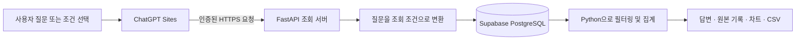
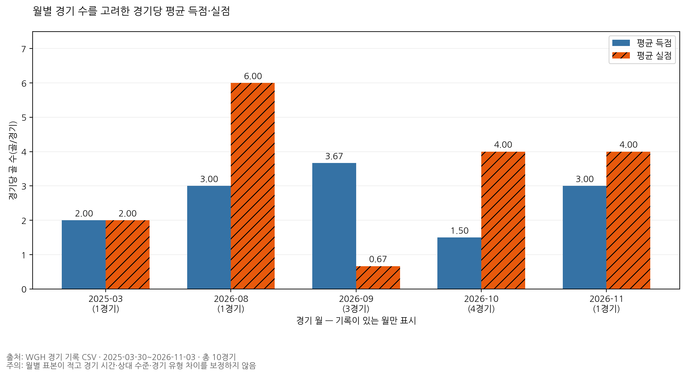
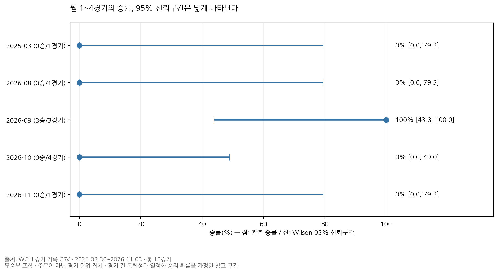
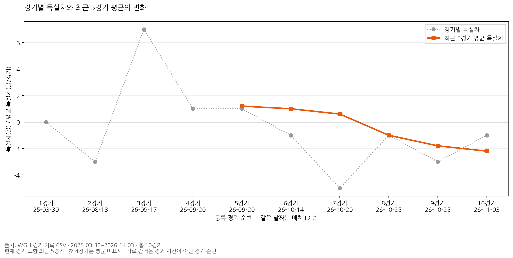

# ⚽ 위고하이 풋살 Q&A

**경기 기록으로 질문하고, 계산에 사용한 원본까지 확인하는 풋살 데이터 분석 챗봇**입니다. 위고하이의 Supabase PostgreSQL에 저장된 경기, 선수, 일정, 영상 메타데이터를 읽기 전용으로 조회해 답과 차트를 제공합니다.

[실행 화면 열기](https://wgh-futsal-data-chat.j-saeyoun.chatgpt.site/) · AI-Powered Python 자동 팩트체킹 실습

> 실행 화면에서 운영 기록을 조회하려면 ChatGPT 로그인이 필요할 수 있습니다. GitHub에는 소스와 검증 요약을 공개합니다.

## 프로젝트 배경

풋살 영상은 쿼터마다 따로 올리기도 합니다. 그래서 “친선경기를 얼마나 했어?”에서 영상 개수와 등록 매치 수를 같은 단위로 세면 다른 결론이 나옵니다. 이 프로젝트는 질문의 대상을 구분하고, 어떤 기록으로 수치를 계산했는지 화면에서 확인할 수 있도록 만들었습니다.

| 질문 | 집계 기준 |
| --- | --- |
| 친선경기 영상 몇 개야? | 영상 제목의 친선경기 분류와 영상 ID |
| 친선경기는 얼마나 했어? | 경기 유형이 친선경기인 등록 매치 |
| 월별 득점을 비교해줘 | 등록 경기 날짜별 팀 득점 합계 |
| 풋살 경기한 장소를 알려줘 | 경기 기록에 저장된 장소명별 경기 수 |

## 데이터와 확인한 사실

2026년 11월 6일에 확인한 운영 기록입니다. 데이터가 추가되면 현재 화면의 수치는 달라질 수 있습니다.

| 확인 항목 | 결과 | 해석 |
| --- | ---: | --- |
| 친선경기 영상 | 87개 | 영상 제목의 분류 기준 |
| 매치 연결 영상 | 19개 | 매치 ID가 있는 영상 |
| 매치 미연결 영상 | 68개 | 전체 87개 중 매치 ID가 없는 영상 |
| 연결된 서로 다른 매치 | 3건 | 연결된 영상 19개의 고유 매치 ID |
| 친선경기로 등록된 매치 | 4건 | 운영 DB 경기 유형 기준 |
| 영상 매치 연결 비율 | 21.8% | 19 ÷ 87 × 100, 소수 첫째 자리 반올림 |

과제에서는 영상 목록에서 영상 ID, 매치 ID, 경기 날짜를 발췌한 87행 × 3열 자료로 결측치와 연결 비율을 계산했습니다. 미연결 영상은 별도로 표시하며, 같은 경기인지 추측해서 매치 수에 더하지 않습니다.

## 화면과 기능

- **홈화면** — 등록 경기, 팀 득점, 승률, 친선경기 영상 수를 카드로 표시하고 월별 차트와 최근 경기 목록을 보여줍니다.
- **조건 분석** — 자료, 기간, 상대팀, 경기 유형, 집계 기준을 골라 조회합니다. 결과와 집계에 사용한 기록을 확인하고 CSV를 내려받을 수 있습니다.
- **풋살 챗봇** — 자주 묻는 질문은 정해진 조회 조건으로 처리합니다. 자유 질문은 AI가 기간·대상·지표를 해석하고, 서버가 실제 기록에서 수치를 계산합니다.
- **근거 확인** — 별도 사실표를 검색하고, 답에 붙은 사실ID를 원문과 대조하는 실습입니다. 운영 DB 집계 화면에서는 사실ID 대신 DB 출처와 집계에 사용한 기록을 표시합니다.

## 데이터가 답과 차트가 되기까지



| 구성 요소 | 사용 기술과 역할 |
| --- | --- |
| 화면 | ChatGPT Sites, HTML·CSS·JavaScript, SVG 차트 |
| 조회 서버 | Vercel, FastAPI, Pydantic |
| 운영 DB | Supabase PostgreSQL, psycopg 읽기 전용 조회 |
| 데이터 분석 | Python, pandas로 필터링·집계 |
| 자유 질문·근거 검색 | OpenAI, LangChain, 인메모리 벡터 검색 |

관계형 DB는 날짜·상대팀·경기 유형처럼 필드에 저장된 값을 기준으로 정확히 조회합니다. 벡터 검색은 표현이 달라도 질문과 뜻이 가까운 사실표 문장을 찾는 데 사용합니다. 승률과 영상 수는 조회한 행으로 계산하며, 벡터 유사도로 결정하지 않습니다.

## 저장소 구조

```text
sites/index.mjs              화면, 차트, 조회 요청 전달
gateway/app.py               FastAPI 진입점, 인증과 응답 구성
gateway/analysis_core.py     질문 해석, 필터 및 집계
gateway/read_wgh_db.py       허용된 자료별 읽기 전용 SQL
gateway/rag.py               사실표 로딩, 검색 및 인용 확인
gateway/requirements.txt    Python 의존성
gateway/vercel.json         별도 Vercel 조회 서버 배포 설정
```

## 처음 실행하는 방법

### 1. 실행 범위 선택

- **화면만 체험** — [배포된 챗봇](https://wgh-futsal-data-chat.j-saeyoun.chatgpt.site/)을 엽니다. Python 설치 없이 볼 수 있으며, 운영 자료를 조회할 때 ChatGPT 로그인 또는 열람 권한이 필요할 수 있습니다.
- **내 PC에서 조회 서버 실행** — Git과 Python 3.12가 필요합니다. 아래 명령으로 서버를 시작하고 `/health`를 확인할 수 있습니다. 웹 대시보드 화면은 ChatGPT Sites에서 별도로 제공됩니다.
- **자체 데이터로 조회** — 본인이 읽을 수 있는 PostgreSQL과 앱의 SQL에 맞는 `wgh` 스키마가 필요합니다. 공개 저장소에는 운영 데이터, DB 스키마 초기화 파일, DB 계정이 포함되어 있지 않습니다.

### 2. 설치 및 시작

저장소를 내려받고 저장소 최상위 폴더에 가상환경 `.venv`를 만듭니다. 가상환경이 이미 있다면 생성 줄을 건너뛰세요. 운영체제에 맞는 명령 한 묶음을 사용합니다.

**Windows PowerShell**

```powershell
git clone https://github.com/YuNi-100/wgh-futsal-qa.git
cd wgh-futsal-qa
py -3.12 -m venv .venv
cd gateway
..\.venv\Scripts\python.exe --version
..\.venv\Scripts\python.exe -m pip install -r requirements.txt
..\.venv\Scripts\python.exe -m uvicorn app:app --host 127.0.0.1 --port 8000
```

**macOS · Linux**

```bash
git clone https://github.com/YuNi-100/wgh-futsal-qa.git
cd wgh-futsal-qa
python3.12 -m venv .venv
cd gateway
../.venv/bin/python --version
../.venv/bin/python -m pip install -r requirements.txt
../.venv/bin/python -m uvicorn app:app --host 127.0.0.1 --port 8000
```

위 명령은 `.venv`를 활성화하지 않아도 해당 Python을 직접 사용합니다. 이미 다른 위치에 가상환경이 있다면 그 위치에 맞춰 실행 경로를 바꾸세요. 예를 들어 `gateway` 안에 만들었다면 Windows에서는 `.\.venv\Scripts\python.exe`, macOS·Linux에서는 `./.venv/bin/python`을 사용합니다.

서버를 켜 둔 상태에서 [http://127.0.0.1:8000/health](http://127.0.0.1:8000/health)를 열어 `{"status":"ok"}`가 표시되는지 확인합니다. 이 경로는 서버가 시작됐는지만 확인하며 DB나 OpenAI 연결을 검사하지 않습니다. 종료하려면 실행한 터미널에서 `Ctrl+C`를 누릅니다.

### 3. 실제 조회용 환경 변수

| 변수 | 설정 위치 | 필요한 경우 |
| --- | --- | --- |
| `WGH_ANALYTICS_DATABASE_URL` | 조회 서버 | 운영 기록 조회. 앱에 필요한 테이블과 열만 조회할 수 있는 PostgreSQL 계정을 사용합니다. |
| `WGH_GATEWAY_TOKEN` | 조회 서버와 Sites | 조회 요청 인증. 양쪽에 동일한 임의의 비밀 값을 넣습니다. |
| `WGH_GATEWAY_URL` | Sites | 조회 서버의 공개 HTTPS 주소. 예시는 `https://your-gateway.example`이며 뒤에 API 경로를 붙이지 않습니다. |
| `OPENAI_API_KEY` | 조회 서버 | 자유 질문 해석과 근거 확인 모드. 조건 조회와 지원되는 정형 질문은 키 없이 사용할 수 있습니다. |

로컬에서는 **서버를 실행할 같은 터미널**에서 환경 변수를 먼저 설정하세요. 아래 값은 자리표시자입니다. 실제 비밀 값은 본인 환경에서만 입력하세요.

```powershell
# Windows PowerShell
$env:WGH_ANALYTICS_DATABASE_URL = '<읽기 전용 PostgreSQL 접속 문자열>'
$env:WGH_GATEWAY_TOKEN = '<서버 간 인증 토큰>'
# 자유 질문 또는 근거 확인을 사용할 경우
$env:OPENAI_API_KEY = '<본인의 OpenAI API 키>'
```

```bash
# macOS · Linux
export WGH_ANALYTICS_DATABASE_URL='<읽기 전용 PostgreSQL 접속 문자열>'
export WGH_GATEWAY_TOKEN='<서버 간 인증 토큰>'
# 자유 질문 또는 근거 확인을 사용할 경우
export OPENAI_API_KEY='<본인의 OpenAI API 키>'
```

서버가 이미 실행 중이면 설정 후 다시 시작합니다. 배포 환경에서는 Vercel 및 Sites의 비밀 설정을 사용하세요. 코드는 운영체제의 환경 변수를 읽으므로 `.env` 파일을 만들어 두는 것만으로는 자동 적용되지 않습니다.

### 4. 조회와 화면 연결 확인

- **조건 조회** — `POST /api/wgh/query`에 `Authorization: Bearer <WGH_GATEWAY_TOKEN>`과 `Content-Type: application/json`을 보내고 본문에 `{"filters":{"dataset":"matches","group":"month","metric":"scored"}}`를 넣으면 월별 경기 집계를 요청할 수 있습니다.
- **자유 질문** — 같은 API에 `{"question":"월별 득점을 비교해줘"}`를 보냅니다. AI가 요청 조건을 해석하고 서버가 실제 수치를 계산합니다.
- **근거 확인** — 공유 가능한 사실표를 `gateway/data/futsal_facts.csv`에 넣습니다. 열 이름은 `사실ID,내용,기준,출처`입니다. 근거 확인 요청에는 `{"question":"사실표에 있는 질문","evidence":true}`를 사용합니다. 현재 API는 근거 확인 요청에도 DB 연결 변수가 설정되어 있어야 진입할 수 있습니다.
- **웹 화면** — `sites/index.mjs`는 ChatGPT Sites용 Worker입니다. Sites에서 제공하는 로그인 환경과 HTTPS 조회 서버를 사용합니다. 로컬 조회 서버의 `127.0.0.1` 주소는 배포된 Sites에서 사용할 수 없습니다.

### 자주 생기는 문제

| 증상 | 확인할 것 |
| --- | --- |
| `python` 또는 `py -3.12`를 찾을 수 없음 | Python 3.12 설치 여부를 확인합니다. Windows에서 Python Launcher가 없다면 설치한 Python 3.12의 경로로 가상환경을 만듭니다. |
| `requirements.txt`를 찾을 수 없음 | 현재 폴더가 `gateway`인지 확인합니다. |
| `ModuleNotFoundError` | 패키지 설치와 서버 실행에 같은 가상환경의 Python을 사용했는지 확인합니다. |
| `/health`는 열리는데 조회가 401 | 요청에 넣은 토큰이 조회 서버의 `WGH_GATEWAY_TOKEN`과 같은지 확인합니다. |
| 조회가 503이거나 자료가 보이지 않음 | DB 연결 변수, PostgreSQL 읽기 권한, `wgh` 스키마를 확인합니다. 조건 조회는 되는데 자유 질문만 실패하면 OpenAI 키와 API 사용 가능 상태를 확인합니다. |
| 포트 8000을 사용할 수 없음 | 서버 실행 명령의 포트를 8001 등으로 변경하고 같은 포트로 접속합니다. |

이 프로젝트의 `gateway/requirements.txt`는 조회 서버 실행에 필요한 패키지 목록입니다. Olist 실습에서 다뤘던 학습 완료 `.pkl` 파일을 읽는 단계는 없습니다.

## 검증과 한계

- 배포 환경에서 친선경기 영상 질문이 **87개**와 매치 연결 상태를 반환하는 것을 확인했습니다.
- 자유 질문으로 월별 득실점을 요청했을 때 표와 차트가 나오는 것과, 등록된 장소명 7개로 장소별 집계를 수행하는 것을 조회 서버에서 확인했습니다.
- 승률의 분모는 조회 범위의 등록 경기 수입니다. 영상에서 실제 경기 수를 재구성하려면 미연결 영상의 동일 경기 여부를 별도로 확인해야 합니다.
- 경기장 구·시가 기록되지 않은 경우 장소명으로 집계합니다. 영상 장면과 회원 전용 AI 분석 내용은 이 챗봇의 조회 범위에 포함하지 않습니다.

---

## 데이터 시각화 추가 분석 실습

기존 `gateway/analysis_core.py`의 경기 수·승률·득실점 합계 분석을 검토하고, 다음 세 가지 분석기법을 별도 Colab 노트북에 추가했다.

[실습 노트북 보기](WGH_풋살_추가분석.ipynb)

분석 대상은 경기 기록 CSV에 포함된 10경기이며, 기간은 2025-03-30~2026-11-03이다.

### 1. 월별 경기당 평균 득점·실점

**질문:** 월마다 경기 수가 다른 점을 고려하면 경기당 평균 득점과 실점은 어떻게 달라질까?

**추가 기법:** 월별 득실점 합계를 경기 수로 나누어 비교했다.

**읽은 결과:** 2026년 9월의 경기당 평균 득점이 3.67골로 가장 높았으며, 해당 월의 기록은 3경기였다.



### 2. 월별 승률과 95% 신뢰구간

**질문:** 월별 승률은 경기 수에 따라 얼마나 불확실할까?

**추가 기법:** Wilson 방법으로 승률의 95% 신뢰구간을 계산했다. 무승부도 승률의 분모에 포함했다.

**읽은 결과:** 2026년 9월은 3전 전승으로 관측 승률이 100%였지만, 95% 신뢰구간은 43.8~100.0%로 넓었다.



### 3. 최근 5경기 평균 득실차

**질문:** 최근 5경기를 묶어서 보면 득실차의 흐름은 어떻게 변할까?

**추가 기법:** 현재 경기와 직전 4경기의 득실차를 평균하는 이동평균을 적용했다.

**읽은 결과:** 첫 5경기의 평균 득실차는 +1.20골/경기였고, 마지막 5경기는 −2.20골/경기였다.



### 기존 분석과 달라진 점

| 기존 분석 | 추가 분석 | 목적 |
|---|---|---|
| 월별 득실점 합계 | 경기당 평균 득실점 | 월별 경기 수 차이를 고려 |
| 승률 | 승률과 95% 신뢰구간 | 적은 표본에 따른 불확실성 표시 |
| 개별 경기 득실차 | 최근 5경기 이동평균 | 경기 결과의 흐름 확인 |

### 한계와 실행 방법

등록된 10경기만 분석했으며 경기 시간·상대팀 수준·경기 유형 차이는 보정하지 않았다. 같은 날짜의 실제 경기 순서가 확인되지 않아 매치 ID 순으로 정렬했다. 결과를 미래 성적이나 경기력 변화의 원인으로 단정하지 않는다.

노트북을 Google Colab에서 열고 경기 기록 CSV를 업로드한 뒤 순서대로 실행한다. 차트는 `images` 폴더에 저장된다. 이번 추가 분석은 노트북에서 수행했으며 기존 웹사이트 기능에 반영한 것은 아니다.

ChatGPT의 도움으로 기존 코드 검토, 분석기법 선정과 코드 작성을 진행하고 Colab에서 실행 결과를 확인했다.

