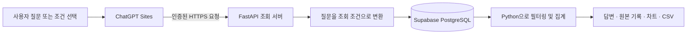

# ⚽ 위고하이 풋살 Q&A

**경기 기록으로 질문하고, 계산에 사용한 원본까지 확인하는 풋살 데이터 분석 챗봇**입니다. 위고하이의 Supabase PostgreSQL에 저장된 경기, 선수, 일정, 영상 메타데이터를 읽기 전용으로 조회해 답과 차트를 제공합니다.

[실행 화면 열기](https://wgh-futsal-data-chat.j-saeyoun.chatgpt.site/) · AI-Powered Python 자동 팩트체킹 실습

> 실행 화면에서 운영 기록을 조회하려면 ChatGPT 로그인이 필요할 수 있습니다. GitHub에는 소스와 검증 요약을 공개합니다.

## 프로젝트 배경

풋살 영상은 쿼터마다 따로 올리기도 합니다. 그래서 “친선경기를 얼마나 했어?”에서 영상 개수와 등록 매치 수를 같은 단위로 세면 다른 결론이 나옵니다. 이 프로젝트는 질문의 대상을 구분하고, 어떤 기록으로 수치를 계산했는지 화면에서 확인할 수 있도록 만들었습니다.

| 질문 | 집계 기준 |
| --- | --- |
| 친선경기 영상 몇 개야? | 영상 제목의 친선경기 분류와 영상 ID |
| 친선경기는 얼마나 했어? | 경기 유형이 친선경기인 등록 매치 |
| 월별 득점을 비교해줘 | 등록 경기 날짜별 팀 득점 합계 |
| 풋살 경기한 장소를 알려줘 | 경기 기록에 저장된 장소명별 경기 수 |

## 데이터와 확인한 사실

2026년 11월 6일에 확인한 운영 기록입니다. 데이터가 추가되면 현재 화면의 수치는 달라질 수 있습니다.

| 확인 항목 | 결과 | 해석 |
| --- | ---: | --- |
| 친선경기 영상 | 87개 | 영상 제목의 분류 기준 |
| 매치 연결 영상 | 19개 | 매치 ID가 있는 영상 |
| 매치 미연결 영상 | 68개 | 전체 87개 중 매치 ID가 없는 영상 |
| 연결된 서로 다른 매치 | 3건 | 연결된 영상 19개의 고유 매치 ID |
| 친선경기로 등록된 매치 | 4건 | 운영 DB 경기 유형 기준 |
| 영상 매치 연결 비율 | 21.8% | 19 ÷ 87 × 100, 소수 첫째 자리 반올림 |

과제에서는 영상 목록에서 영상 ID, 매치 ID, 경기 날짜를 발췌한 87행 × 3열 자료로 결측치와 연결 비율을 계산했습니다. 미연결 영상은 별도로 표시하며, 같은 경기인지 추측해서 매치 수에 더하지 않습니다.

## 화면과 기능

- **홈화면** — 등록 경기, 팀 득점, 승률, 친선경기 영상 수를 카드로 표시하고 월별 차트와 최근 경기 목록을 보여줍니다.
- **조건 분석** — 자료, 기간, 상대팀, 경기 유형, 집계 기준을 골라 조회합니다. 결과와 집계에 사용한 기록을 확인하고 CSV를 내려받을 수 있습니다.
- **풋살 챗봇** — 자주 묻는 질문은 정해진 조회 조건으로 처리합니다. 자유 질문은 AI가 기간·대상·지표를 해석하고, 서버가 실제 기록에서 수치를 계산합니다.
- **근거 확인** — 별도 사실표를 검색하고, 답에 붙은 사실ID를 원문과 대조하는 실습입니다. 운영 DB 집계 화면에서는 사실ID 대신 DB 출처와 집계에 사용한 기록을 표시합니다.

## 데이터가 답과 차트가 되기까지



| 구성 요소 | 사용 기술과 역할 |
| --- | --- |
| 화면 | ChatGPT Sites, HTML·CSS·JavaScript, SVG 차트 |
| 조회 서버 | Vercel, FastAPI, Pydantic |
| 운영 DB | Supabase PostgreSQL, psycopg 읽기 전용 조회 |
| 데이터 분석 | Python, pandas로 필터링·집계 |
| 자유 질문·근거 검색 | OpenAI, LangChain, 인메모리 벡터 검색 |

관계형 DB는 날짜·상대팀·경기 유형처럼 필드에 저장된 값을 기준으로 정확히 조회합니다. 벡터 검색은 표현이 달라도 질문과 뜻이 가까운 사실표 문장을 찾는 데 사용합니다. 승률과 영상 수는 조회한 행으로 계산하며, 벡터 유사도로 결정하지 않습니다.

## 저장소 구조

```text
sites/index.mjs              화면, 차트, 조회 요청 전달
gateway/app.py               FastAPI 진입점, 인증과 응답 구성
gateway/analysis_core.py     질문 해석, 필터 및 집계
gateway/read_wgh_db.py       허용된 자료별 읽기 전용 SQL
gateway/rag.py               사실표 로딩, 검색 및 인용 확인
gateway/requirements.txt    Python 의존성
gateway/vercel.json         별도 Vercel 조회 서버 배포 설정
```

## 실행 및 설정

Python 3.12 환경에서 아래 명령을 실행합니다.

```bash
cd gateway
python -m pip install -r requirements.txt
python -m uvicorn app:app --host 127.0.0.1 --port 8000
```

`GET /health`로 서버 시작을 확인합니다. 실제 자료 요청은 `POST /api/wgh/query`를 사용하며 조회 서버 전용 토큰이 필요합니다. ChatGPT Sites에 화면을 배포할 때는 해당 Sites의 비밀 설정에 조회 서버 주소와 토큰을 등록합니다.

| 환경 | 변수 | 용도 |
| --- | --- | --- |
| 조회 서버 | `WGH_ANALYTICS_DATABASE_URL` | 운영 DB 읽기 전용 연결 |
| 조회 서버, Sites | `WGH_GATEWAY_TOKEN` | 두 서버 사이 인증용 비밀 값 |
| Sites | `WGH_GATEWAY_URL` | 조회 서버의 HTTPS 주소 |
| 조회 서버 | `OPENAI_API_KEY` | 자유 질문 해석과 근거 답변 |

별도로 근거 확인 모드를 실행할 때는 공유 가능한 `gateway/data/futsal_facts.csv`를 준비합니다. 이 앱의 사실표 열은 `사실ID,내용,기준,출처`입니다. 운영 DB 연결 정보, API 키, 운영 자료 파일은 이 공개 저장소에 포함되어 있지 않습니다.

## 검증과 한계

- 배포 환경에서 친선경기 영상 질문이 **87개**와 매치 연결 상태를 반환하는 것을 확인했습니다.
- 자유 질문으로 월별 득실점을 요청했을 때 표와 차트가 나오는 것과, 등록된 장소명 7개로 장소별 집계를 수행하는 것을 조회 서버에서 확인했습니다.
- 승률의 분모는 조회 범위의 등록 경기 수입니다. 영상에서 실제 경기 수를 재구성하려면 미연결 영상의 동일 경기 여부를 별도로 확인해야 합니다.
- 경기장 구·시가 기록되지 않은 경우 장소명으로 집계합니다. 영상 장면과 회원 전용 AI 분석 내용은 이 챗봇의 조회 범위에 포함하지 않습니다.

